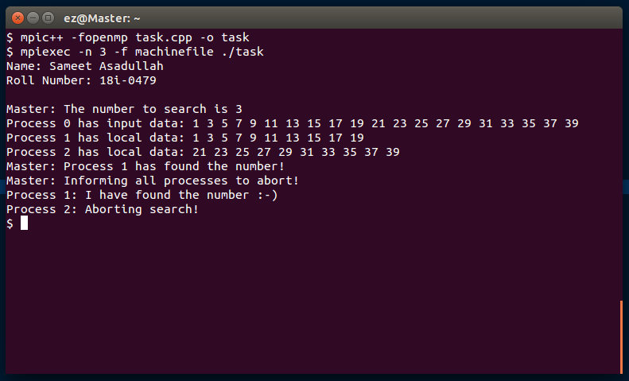
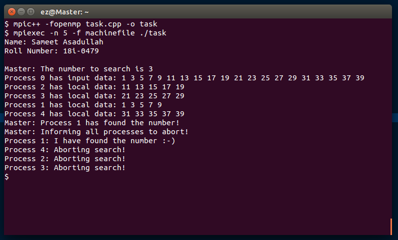

<h1 align="center">Searching a Number Among Slave Processes Using OpenMP and MPI</h1>

### Description
A hybrid C++ search that partitions an array across MPI workers and uses OpenMP within each process. The supporting [problem specification](Project%20Statement.pdf) is retained with the implementation.

### Manual
1) Use following command to `Compile the Code`:
    ```
    mpic++ -fopenmp Source.cpp -o Source
    ```

2) Use following command to `Execute the Code`. 3 indicates total number of processes to create:
    ```
    mpiexec -n 3 -f machinefile ./Source
    ```
    
### Working Screenshots
<div align="center">
  
</div>
<br/>
<div align="center">
  
</div>
