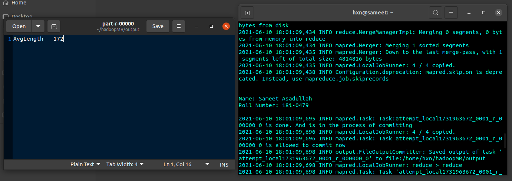

<h1 align="center">Finding Average Length of Comments Using MapReduce Hadoop</h1>

### Description
A Java Hadoop MapReduce pipeline that computes aggregate comment-length statistics over large datasets.
    
### Working Screenshot

  

