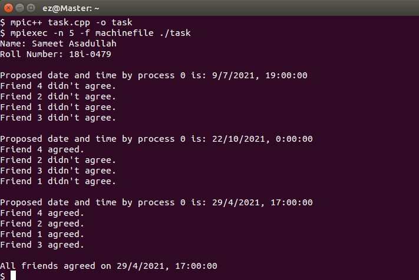

<h1 align="center">Consensus Problem using MPI</h1>

### Description
A distributed C++ consensus implementation using MPI processes and message passing.

### Manual
1) Use following command to `Compile the Code`:
    ```
    mpic++ main.cpp -o main
    ```

2) Use following commands to `Execute the Code`. Here 5 represents total number of processes to create:
    ```
    mpiexec -n 5 -f machinefile ./main
    ```
    
### Working Screenshot
<div align="center">
  
</di
