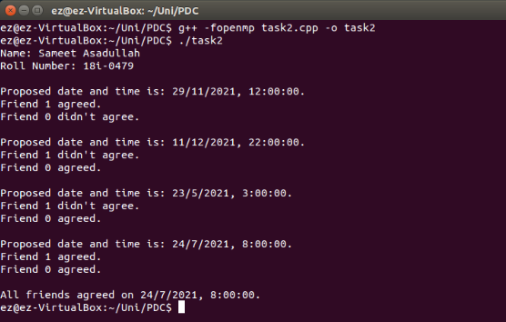

<h1 align="center">Consensus Problem using OpenMP</h1>

### Description
Program coded in `C++ language` to solve the `Consensus Problem` between `Multiple Threads` using `OpenMP`.

### Manual
1) Use following command to `Compile the Code`:
    ```
    mpic++ -fopenmp main.cpp -o main
    ```

2) Use following commands to `Execute the Code`:
    ```
    ./main
    ```
    
### Working Screenshot
<div align="center">
  
</di
